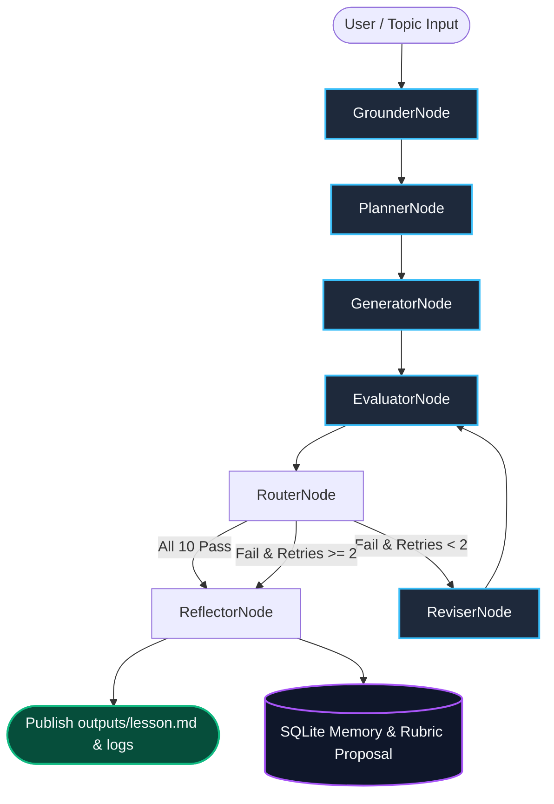

# Agent Ecosystem & Node Specifications (`AGENTS.md`)

This document defines the agent architecture, system prompts, personas, schemas, and state transitions powering the Autonomous Lesson Generation & Evaluation System.

---

## 1. Multi-Node Agentic Architecture

The system is constructed as a cyclic state machine using **LangGraph**. Unlike naive generation scripts, our architecture separates concerns into specialized nodes that observe, evaluate, criticize, and remediate educational content.



---

## 2. Agent Catalog & Node Specifications

### 2.1 Grounder Node (`GrounderNode`)
* **Role**: Immutable Domain Anchor & Memory Bridge
* **Persona**: Objective curator of canonical scientific knowledge.
* **Responsibilities**:
  1. Loads verified technical facts from `data/fact_pack.json` (grounded in Lewis et al., 2020 NeurIPS paper and official vendor docs with source URLs).
  2. Loads canonical terminology definitions from `data/glossary.json` (12 core terms).
  3. Queries `data/memory.db` for the top 5 active learned rules evolved from past runs.
* **Input State**: `LessonState(topic, max_retries, fault_to_inject)`
* **Output State**: `{"fact_pack": List[FactItem], "glossary": Dict[str, str], "learned_rules": List[str]}`
* **Why Separate**: Decouples domain truth from LLM weights, preventing the hallucination of technical facts at generation time.

---

### 2.2 Planner Node (`PlannerNode`)
* **Role**: Instructional Curriculum Architect
* **Persona**: Master STEM educator specialized in designing accessible curricula for non-native English learners.
* **Responsibilities**:
  1. Synthesizes a must-cover checklist for What, Why, and How of the topic.
  2. Enforces coverage of all 8 core concepts: `retrieval`, `embeddings`, `vector database`, `chunking`, `augmenting the prompt`, `generation`, `hallucination reduction`, `limitations`.
  3. Outlines an India-relevant scenario (e.g., college admission chatbot processing PDF circulars) and an open-book exam analogy.
* **Model**: Configured via `GENERATOR_MODEL` (default: `gemini-3.5-flash-lite`, temperature: 0.2).
* **System Prompt Excerpt**:
  > *"You are an expert curriculum designer. Produce a structured lesson plan covering What RAG is, Why models need it, and How it works. Ensure the 8 mandatory technical concepts are targeted without using college-level jargon."*
* **Output Schema**: `LessonPlan(must_cover=WhatWhyHow, key_concepts=List[str], outline=List[str])`

---

### 2.3 Generator Node (`GeneratorNode`)
* **Role**: Pedagogical Content Drafter
* **Persona**: Compassionate, plain-speaking teacher writing for a 12th-grade Indian high school graduate with limited English vocabulary.
* **Responsibilities**:
  1. Drafts an 800–1200 word Markdown lesson based on the outline, verified facts, and learner persona.
  2. Adheres strictly to plain-language style rules: one idea per sentence, short sentences, everyday words, no long clause chains, defining each term at first use.
  3. **Zero Test-Leakage**: Receives plain pedagogical requirements; does **not** receive exact numeric formulas (e.g. FK $\le 7.0$ or sentence length $\le 15.0$).
  4. Dynamically injects learned rules from SQLite memory into its generation prompt.
  5. Implements the optional CLI fault injection hook (`--inject-fault`) on Attempt 0 for live demonstration.
* **Model**: Configured via `GENERATOR_MODEL` (temperature: 0.7 for creative, relatable pedagogy).
* **Output Schema**: Appends new `LessonAttempt(attempt_number=0, content=lesson_md)` to `LessonState.attempts`.

---

### 2.4 Evaluator Node (`EvaluatorNode` - Hybrid Judge)
* **Role**: Strict QA & Pedagogical Certification Authority
* **Persona**: Literal, uncompromising quality auditor applying hard binary pass/fail standards with zero partial credit.
* **Architecture**: **Hybrid Two-Tier Engine**:
  1. **Tier 1 - Deterministic Code Checks**:
     - `reading_level`: Markdown stripped -> Flesch-Kincaid Grade $\le 7.0$ AND Average Sentence Length $\le 15.0$ words.
     - `jargon_defined`: All 12 glossary terms checked for explicit definitions upon first appearance in body prose.
     - `wrap_up`: Code parses the final `## Self-Check` section, verifying exactly 3 numbered questions.
  2. **Tier 2 - LLM Qualitative Judge**:
     - Single structured Pydantic batch call (`accuracy`, `what_why_how`, `key_points`, `no_idioms`, `worked_example`, `analogy`, `coherent_flow`, plus qualitative wrap-up).
     - **Verbatim Evidence Verification**: Every flagged violation must include an exact verbatim quote from the lesson. The Python harness verifies `evidence_quote in lesson_text`. Missing quotes or hallucinations are rejected and retried.
* **Model**: Independent `JUDGE_MODEL` (default: `gemini-3.1-flash-lite`, temperature: 0.2).
* **Output Schema**: `EvaluationResult(passed=bool, checks=List[CheckResult], failing_checks=List[str])`.

---

### 2.5 Router Node (`RouterNode`)
* **Role**: Deterministic Workflow Dispatcher
* **Logic**:
  - `if eval_result.passed == True` $\rightarrow$ Branch to `ReflectorNode` (Lesson certified).
  - `if not eval_result.passed and state.current_attempt < state.max_retries` $\rightarrow$ Branch to `ReviserNode` (Self-correction).
  - `if not eval_result.passed and state.current_attempt >= state.max_retries` $\rightarrow$ Branch to `ReflectorNode` (Budget exhausted; mark `NEEDS_HUMAN_REVIEW` and ship best attempt with fewest failing checks).

---

### 2.6 Reviser Node (`ReviserNode`)
* **Role**: Surgical Remediation Specialist
* **Persona**: Precision technical editor.
* **Responsibilities**:
  1. Receives the rejected draft, failing check IDs, diagnostic reasons, and verbatim quotes.
  2. Modifies **only** the offending paragraphs while preserving all passing sections intact.
  3. Produces a concise `changes_made` summary naming each failing check and what was revised.
* **Model**: Configured via `GENERATOR_MODEL` (temperature: 0.3 for precision editing).
* **Output Schema**: Appends updated `LessonAttempt(attempt_number=n+1, content=revised_md, changes_made=summary)` to `LessonState.attempts`.

---

### 2.7 Reflector Node (`ReflectorNode`)
* **Role**: Meta-Cognitive Self-Evolution & Governance Officer
* **Persona**: Continuous learning engineer.
* **Responsibilities**:
  1. Persists run telemetry, attempts, check scores, and quotes into SQLite (`data/memory.db`).
  2. Analyzes failure patterns across attempts; synthesizes actionable rules and deduplicates them.
  3. Caps active rules at the top 5 by recurrence count, deactivating lower-ranked rules.
  4. Proposes versioned rubric refinements in `data/rubric_v2_proposed.json` with a human-readable changelog.
* **Output Schema**: Updates `state.learned_rules` and writes `rubric_v2_proposed.json`.

---

## 3. Pydantic State Schemas

The entire state lifecycle is strictly validated by Pydantic models in `src/schemas.py`:

```python
class CheckResult(BaseModel):
    check_id: str
    passed: bool
    reason: str
    evidence_quote: str = ""

class EvaluationResult(BaseModel):
    passed: bool
    checks: List[CheckResult]
    failing_checks: List[str]

class LessonAttempt(BaseModel):
    attempt_number: int
    content: str
    evaluation: Optional[EvaluationResult] = None
    changes_made: Optional[str] = None
    timestamp: datetime = Field(default_factory=datetime.now)

class LessonState(BaseModel):
    run_id: str = Field(default_factory=lambda: datetime.now().strftime("%Y%m%d_%H%M%S"))
    topic: str
    max_retries: int = 2
    status: str = "generating"  # "generating", "passed", "needs_human_review"
    current_attempt: int = 0
    fact_pack: List[FactItem] = []
    glossary: Dict[str, str] = {}
    learned_rules: List[str] = []
    attempts: List[LessonAttempt] = []
```

