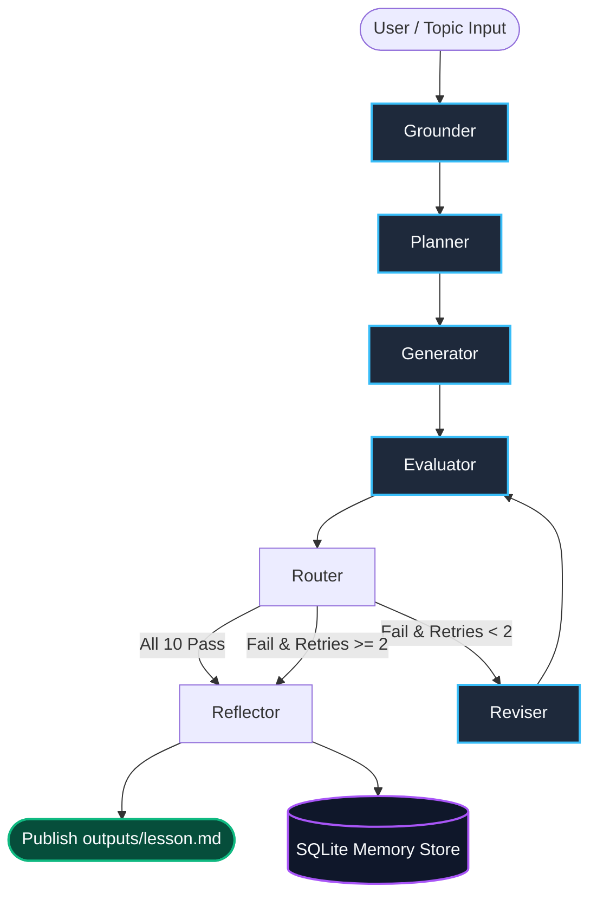

# Autonomous Educational Content Generation & Self-Correcting Evaluation System

[](https://www.python.org/downloads/)
[](https://github.com/langchain-ai/langgraph)
[](https://ai.google.dev/)
[]()
[-success.svg)]()

> **GenAI Engineer - Content Systems Take-Home Assessment**  
> An autonomous agentic system built with LangGraph and the Google Gemini API that writes, evaluates, surgically revises, and self-evolves introductory technical lessons for underrepresented learners.

---

## 1. Problem & Mission

Teaching complex Generative AI concepts to beginner audiences is notoriously prone to three systemic failure modes:
1. **Academic Jargon Overload**: Models generate dense, multi-clause paragraphs filled with undefined terms and Western colloquialisms.
2. **Technical Hallucination**: Models state falsehoods (e.g., claiming RAG retrains neural network weights).
3. **Passive Monologue**: Lessons lack interactive mental models, analogies, worked examples, and check-for-understanding quizzes.

### Target Learner Persona
* **Demographic**: 12th-grade high-school graduate from India (~17–19 years old).
* **Education**: Non-English-medium schooling background (state board / vernacular primary instruction).
* **Vocabulary**: Limited English vocabulary; struggles with sentences $>15$ words, corporate buzzwords, and foreign idioms.
* **Goal**: Aspires to enter the Indian AI engineering workforce and needs crystal-clear, intuitive mental models.

---

## 2. Architecture: LangGraph Cyclic State Machine

The pipeline is implemented as a deterministic cyclic graph with state persistence and human-in-the-loop governance:



### Node Responsibilities
1. **Grounder**: Ingests `data/fact_pack.json` (grounded in Lewis et al., 2020 NeurIPS paper with verified URLs), `data/glossary.json` (12 core terms), and active `learned_rules` from SQLite.
2. **Planner**: Produces a must-cover checklist (What, Why, How), enforces all 8 mandatory concepts, and outlines the lesson.
3. **Generator**: Drafts an 800–1200 word Markdown lesson adhering to plain-language constraints without receiving numeric test thresholds.
4. **Evaluator (Hybrid Engine)**: Evaluates the draft against 10 hard binary pass/fail standards with zero partial credit. Requires verbatim evidence quotes for any flagged violation.
5. **Router**: Conditional branching edge enforcing a hard upper bound of 2 retries before escalating to human review.
6. **Reviser**: Performs surgical, targeted edits to failing sections while preserving passing text, logging a clear `changes_made` summary.
7. **Reflector**: Extracts recurring failure patterns into SQLite `learned_rules`, caps active rules at top 5, and writes versioned rubric proposals in `data/rubric_v2_proposed.json`.

---

## 3. The 10 Hard Pass/Fail Rubric Checkpoints

| # | Check ID | Type | Hard Standard / Criterion | Threshold / Rule |
| :-: | :--- | :--- | :--- | :--- |
| **1** | `accuracy` | LLM Judge | Factual alignment with Lewis et al. (2020). Base model weights must remain completely frozen; RAG never modifies weights. | Binary (Pass/Fail) |
| **2** | `what_why_how` | LLM Judge | Dedicated coverage answering: (1) What RAG is, (2) Why models hallucinate/need it, (3) How retrieval augments the prompt. | Binary (Pass/Fail) |
| **3** | `key_points` | LLM Judge | Explicit pedagogical coverage of all 8 mandatory concepts: retrieval, embeddings, vector database, chunking, prompt augmentation, generation, hallucination reduction, limitations. | All 8 required |
| **4** | `jargon_defined` | Hybrid | All 12 glossary terms defined at first use with zero prior technical knowledge assumed. | Zero ungrounded jargon |
| **5** | `reading_level` | Deterministic | Flesch-Kincaid Grade Level $\le 7.0$ **AND** Average Sentence Length $\le 15.0$ words (evaluated after markdown stripping). | Both $\le$ thresholds met |
| **6** | `no_idioms` | LLM Judge | Zero Western colloquialisms or culturally opaque idioms (e.g. "bite the bullet", "silver bullet", "hit the ground running"). | Binary (Pass/Fail) |
| **7** | `worked_example` | LLM Judge | Step-by-step 3-stage worked example situated in an Indian educational context (e.g. college admission chatbot reading an exam PDF circular). | Concrete 3-step scenario |
| **8** | `analogy` | LLM Judge | Intuitive open-book vs closed-book exam comparison introduced early. | Binary (Pass/Fail) |
| **9** | `coherent_flow` | LLM Judge | Logical progression: Problem (memory limit) $\rightarrow$ Solution (RAG) $\rightarrow$ Mechanics (Chunking/Vectors) $\rightarrow$ Limits. | Binary (Pass/Fail) |
| **10** | `wrap_up` | Hybrid | Dedicated sections: `## Worked Example`, `## Summary`, and `## Self-Check` with exactly 3 numbered questions. | Exact structural match |

---

## 4. Benchmark & Evaluator Catch-Rate Table

Tested across 8 deliberately flawed bad lessons (each engineered to violate specific rubric dimensions) and 1 golden lesson:

| Test Lesson File | Targeted Violation | Live Gemini Judge Status | Extra Caught Checks |
| :--- | :--- | :---: | :--- |
| `bad_accuracy.md` | `accuracy` | **CAUGHT** | `reading_level` |
| `bad_what_why_how.md` | `what_why_how` | **CAUGHT** | None |
| `bad_key_points.md` | `key_points` | **CAUGHT** | None |
| `bad_jargon.md` | `jargon_defined` | **CAUGHT** | None |
| `bad_reading_level.md` | `reading_level` | **CAUGHT** | `no_idioms` |
| `bad_no_idioms.md` | `no_idioms` | **CAUGHT** | None |
| `bad_worked_example.md`| `worked_example` | **CAUGHT** | None |
| `bad_wrap_up.md` | `wrap_up` | **CAUGHT** | None |
| `good_rag_lesson.md` | *(Golden Lesson - All 10)* | **PASSED (10/10)** | Zero fails (100% certified) |

* **Bad Lessons Catch-Rate**: **8/8 (100.0%)** on the real Gemini live evaluator.
* **Offline Unit Test Suite**: **24/24 tests passing in < 10s**.

---

## 5. Quickstart & Installation

### Prerequisites
* Python 3.10, 3.11, or 3.12
* Google Gemini API Key from [Google AI Studio](https://aistudio.google.com/)

### 1. Clone & Set Up Virtual Environment
```bash
git clone <repo_url>
cd "nxtwave assignment"

python -m venv venv
# Windows:
.\venv\Scripts\activate
# Linux/macOS:
source venv/bin/activate

pip install -r requirements.txt
```

### 2. Configure Environment (`.env`)
Create a `.env` file in the project root:
```env
GEMINI_API_KEY=your_gemini_api_key_here
GENERATOR_MODEL=gemini-3.5-flash-lite
JUDGE_MODEL=gemini-3.1-flash-lite
MAX_RETRIES=2
LOG_LEVEL=INFO
```

---

## 6. CLI Usage & Demonstration Modes

### 1. Autonomous Live Generation & Evaluation
Generates a lesson from scratch, runs hybrid evaluation, and applies surgical revisions until certified:
```bash
python main.py --topic "Introduction to RAG (Retrieval-Augmented Generation)"
```

### 2. Live Fault Injection (Testing Evaluator & Reviser)
Deliberately introduces a flaw on Attempt 0 to witness evaluator rejection and surgical revision in real time:
```bash
# Injects false claim that RAG fine-tunes neural network weights:
python main.py --inject-fault hallucination

# Strips the Self-Check quiz:
python main.py --inject-fault no_quiz
```

### 3. Memory & Self-Evolution Demo
Runs 3 sequential iterations demonstrating cold start, failure pattern extraction, rule persistence in SQLite, rule injection into the prompt, and attempt-0 failure reduction:
```bash
python main.py --demo-evolution
```

### 4. Zero-API Replay Mode (Rich CLI)
Re-renders the visual Rich UI (evaluation grids, rejection critique, verbatim evidence quotes, and certification card) for any past run without spending API tokens:
```bash
# Replay latest run:
python main.py --replay latest

# Replay specific run ID:
python main.py --replay 20261107_130604
```

### 5. Running the Test Suite
```bash
# Run 24 offline unit tests (mocked, instant):
pytest -m "not live"

# Run live integration catch-rate suite on real Gemini API:
python tests/test_evaluator.py --live
```

---

## 7. Artifact Outputs

At the completion of every run, structured artifacts are published to `outputs/`:
* **`outputs/lesson.md`**: The published, certified Markdown lesson.
* **`outputs/rejection_log.json`**: Machine-readable telemetry recording all attempts, failing checks, diagnostic reasons, evidence quotes, and revision diffs.
* **`outputs/rejection_log.md`**: Human-readable Markdown audit trail.
* **`outputs/runs/<run_id>/attempt_<n>.json`**: Granular attempt-level traces capturing raw content and evaluations.
* **`data/memory.db`**: Persistent SQLite database containing run histories, check telemetry, and deduplicated learned rules.
* **`data/rubric_v2_proposed.json`**: Safely proposed rubric refinements generated by the Reflector with an audit changelog.

---

## 8. Key Architectural Decisions & Trade-Offs

### A. Independent Models for Generator and Judge
* **Decision**: We decouple generation (`GENERATOR_MODEL`) from evaluation (`JUDGE_MODEL`) and execute at distinct temperatures ($0.7$ for creative teaching, $0.2$ for strict grading).
* **Trade-off**: Increases API complexity, but eliminates self-grading bias and circular agreement.

### B. Verbatim Evidence Quote Verification
* **Decision**: For every qualitative violation, the judge must provide an `evidence_quote` copied verbatim from the text. A Python validation layer checks `evidence_quote in lesson_text`.
* **Trade-off**: Requires strict prompt enforcement and judge retries if quotes hallucinate, but guarantees that rejection critiques are 100% grounded and verifiable.

### C. Surgical Revisions vs. Full Rewrites
* **Decision**: The Reviser receives the rejected text, the failed checks, and evidence quotes, and is instructed to patch only the offending paragraphs.
* **Trade-off**: Full rewrites are simpler to prompt, but frequently cause regressions in previously passing sections. Surgical edits converge within 1–2 revisions and drastically reduce latency and token usage.

### D. Safe Self-Evolution with Human Governance
* **Decision**: The Reflector node synthesizes learned rules into prompt guidance (capped at top 5 active rules), but **never** silently alters the active evaluation rubric. Instead, it writes proposed versioned updates to `rubric_v2_proposed.json`.
* **Trade-off**: Prevents reward hacking and standard degradation while enabling continuous prompt refinement across runs.

---

## 9. Honest Limitations & Vulnerabilities

1. **Same-Family Provider Risk**:
   - *Limitation*: Currently, both the Generator (`gemini-3.5-flash-lite`) and Judge (`gemini-3.1-flash-lite`) originate from Google's Gemini family.
   - *Risk*: Models trained on similar RLHF datasets may share blindspots regarding subtle tone subtleties or cultural nuances.
   - *Production Solution*: In high-stakes production environments, deploy cross-family evaluation (e.g. Anthropic Claude 3.5 Sonnet or OpenAI GPT-4o as judge) or specialized discriminator models.
2. **Readability Formula Calibration**:
   - *Limitation*: Flesch-Kincaid Grade Level relies on syllable counts and sentence length, designed primarily for native English students in American grade schools.
   - *Risk*: A low FK grade ($\le 7.0$) does not automatically guarantee Indian regional comprehensibility if technical metaphors are too abstract.
   - *Mitigation*: We pair the mathematical formula with qualitative checks (`no_idioms`, `worked_example` with an Indian context, `jargon_defined`).
3. **Free-Tier Rate Limits**:
   - *Limitation*: Free-tier API quotas impose strict requests-per-minute (RPM) limits.
   - *Mitigation*: Implemented exponential backoff with jitter on HTTP 429/503 errors and single-pass structured judge calls returning all qualitative checks in one request.

---

## 10. Repository Structure

```
├── .env.example                # Sample environment configuration
├── AGENTS.md                   # Multi-agent specifications & prompts
├── main.py                     # CLI entrypoint with Rich terminal UI
├── pytest.ini                  # Pytest configuration & markers
├── requirements.txt            # Project dependencies
├── data/
│   ├── fact_pack.json          # 12 verified facts grounded in Lewis et al. (2020)
│   ├── glossary.json           # 12 core technical terms
│   ├── memory.db               # SQLite persistent memory store
│   ├── rubric_v1.json          # Active 10-check hard pass/fail specification
│   └── rubric_v2_proposed.json # Auto-evolved proposed rubric with changelog
├── docs/
│   ├── DESIGN.md               # Architecture, decisions, and check change rationale
│   └── LOOM_SCRIPT.md          # 5-minute live demonstration recording script
├── outputs/
│   ├── lesson.md               # Latest published passing lesson
│   ├── rejection_log.json      # Structured audit trail
│   ├── rejection_log.md        # Human-readable markdown audit trail
│   └── runs/                   # Granular attempt traces per run
├── src/
│   ├── checks/
│   │   ├── deterministic.py    # Flesch-Kincaid, glossary, and structure checks
│   │   └── llm_judge.py        # Independent LLM judge with quote verification
│   ├── memory/
│   │   └── store.py            # SQLite memory, deduplication, and active rule capping
│   ├── nodes/
│   │   ├── grounder.py         # Loads facts, glossary, and active memory rules
│   │   ├── planner.py          # Synthesizes checklist and outline
│   │   ├── generator.py        # Drafts beginner Markdown lesson
│   │   ├── evaluator.py        # Hybrid evaluation coordinator
│   │   ├── router.py           # Conditional retry edge
│   │   ├── reviser.py          # Surgical paragraph repair
│   │   └── reflector.py        # Meta-learning and rubric v2 synthesis
│   ├── fault_injector.py       # Deterministic fault injection hooks
│   ├── graph.py                # LangGraph state machine workflow
│   ├── schemas.py              # Strict Pydantic state models
│   └── ui.py                   # Rich CLI terminal formatter & replay engine
└── tests/
    ├── bad_lessons/            # 8 deliberately flawed benchmark lessons
    ├── good_lessons/           # 1 golden lesson passing 10/10
    └── test_evaluator.py       # Offline and live catch-rate benchmark suite
```
